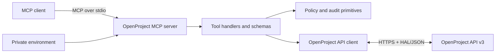

# Architecture

OpenProject MCP is a local, general-purpose stdio server. A compatible MCP client starts the process, the server validates tool input and policy decisions, and the API client communicates only with the configured OpenProject API v3 origin.

## Components

- `scripts/server.ts` loads configuration, registers core tools, and applies the current staged policy gate.
- `scripts/expanded-tools.ts` registers the broader inherited project, task, attachment, relation, user, watcher, notification, board, and reference-data surface.
- `scripts/policy.ts` parses fail-closed public configuration, evaluates preview/write/destructive decisions, and creates sanitized audit records.
- `scripts/openproject-api.ts` owns HTTP authentication, HAL helpers, filter encoding, multipart transfers, timeouts, and API error handling.
- `tests/` contains deterministic request, relation, upload-root, and policy tests.

## Mutation path

The policy foundation starts with no write authority. A policy-gated mutation follows this order:

1. The tool resolves its target context.
2. Without `confirm: true`, it returns a preview and makes no mutation request.
3. With confirmation, the policy requires `OPENPROJECT_WRITE_ENABLED=true`.
4. Project and work-package type IDs must match configured allowlists when supplied.
5. Destructive actions additionally require `OPENPROJECT_ALLOW_DESTRUCTIVE=true`.
6. The server emits a sanitized audit decision to stderr when auditing is enabled.

Every registered mutation passes through preview-first policy handling. Confirmed inherited mutations resolve ownership from verified HAL resources before policy evaluation and can execute when that scope is allowed. When no target can establish scope, `create_work_package`, `mark_all_notifications_read`, and top-level `create_project` require an explicit `projectId`; the latter uses it only as configured authorization scope, while a subproject derives scope from `parentId`. Unresolved or mismatched scope fails closed. The wrapper evaluates policy once; `create_work_package` supplies its resolved work-package type in that same decision. The policy module remains independent so deterministic coverage can run without a live OpenProject instance. Disposable-instance validation is still required for version-specific endpoint contracts.

## Security boundaries

- The API token stays in a local environment source and is sent only to the configured OpenProject origin.
- OpenProject remains the authorization authority; the server cannot exceed the API token owner's permissions.
- Read, write, and destructive tools carry separate MCP annotations.
- The GET escape hatch rejects absolute URLs and paths outside `/api/v3`.
- Attachment transfers enforce size limits; uploads resolve symlinks and stay inside configured roots.
- Policy audit output redacts credential-shaped fields and private-loopback URLs.

For operational setup and constraints, see the [README](../README.md) and [Security Policy](../SECURITY.md).
