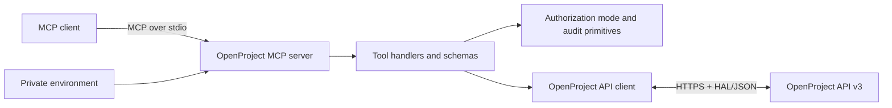

# Architecture

OpenProject MCP is a local, general-purpose stdio server. A compatible MCP client starts the process, the server validates tool input and technical safeguards, and the API client communicates only with the configured OpenProject API v3 origin.

## Components

- `scripts/server.ts` loads configuration, registers core tools, and applies preview plus authorization-mode handling to inherited writes.
- `scripts/expanded-tools.ts` registers the broader inherited project, task, attachment, relation, user, watcher, notification, board, and reference-data surface.
- `scripts/policy.ts` parses authorization configuration, evaluates preview and optional restricted decisions, and creates sanitized audit records.
- `scripts/openproject-api.ts` owns HTTP authentication, HAL helpers, filter encoding, multipart transfers, timeouts, and API error handling.
- `tests/` contains deterministic request, relation, upload-root, authorization-mode, and policy tests.

## Mutation path

Every registered mutation follows this order:

1. Without `confirm: true`, it returns a preview and makes no mutation request.
2. In default `native` mode, the handler applies technical target-resolution, ownership, route, payload, lock-version, and destructive annotation safeguards, then OpenProject authorizes the API request.
3. In optional `restricted` mode, the existing local write, project, type, tool, destructive, module, and membership policy controls additionally apply and fail closed.
4. The server emits a sanitized audit decision with the active mode when auditing is enabled.

Native mode does not deny an operation because a project, type, tool, membership, or module is absent from repository-managed policy. Where a handler needs live target information for route correctness or stale-write protection, it still reads that information. OpenProject returns the native permission, availability, conflict, and validation outcomes. Upload roots remain independent because the OpenProject token cannot authorize local filesystem reads.

## Migration

`OPENPROJECT_AUTHORIZATION_MODE` accepts `native` or `restricted`. When absent, a clean environment defaults to `native`; an environment containing v0.6.3 restriction variables is inferred as `restricted` and emits a startup warning. This preserves existing managed restrictions while allowing normal users to configure only URL and token.

## Security boundaries

- The API token stays in a local environment source and is sent only to the configured OpenProject origin.
- In native mode, the server runs technical preflight for exact target, namespace, ownership, route, payload, and lock-version evidence before the handler executes once. It skips only local ACL authorization; OpenProject remains the authorization authority and the server cannot exceed the API token owner's permissions.
- MCP client tool permissions are separate from server authorization mode and OpenProject permissions.
- Read, write, and destructive tools carry separate MCP annotations.
- The GET escape hatch rejects absolute URLs and paths outside `/api/v3`.
- Attachment transfers enforce size limits; uploads resolve symlinks and stay inside configured roots.
- Policy audit output redacts credential-shaped fields and private-loopback URLs.

For operational setup and constraints, see the [README](../README.md) and [Security Policy](../SECURITY.md).
